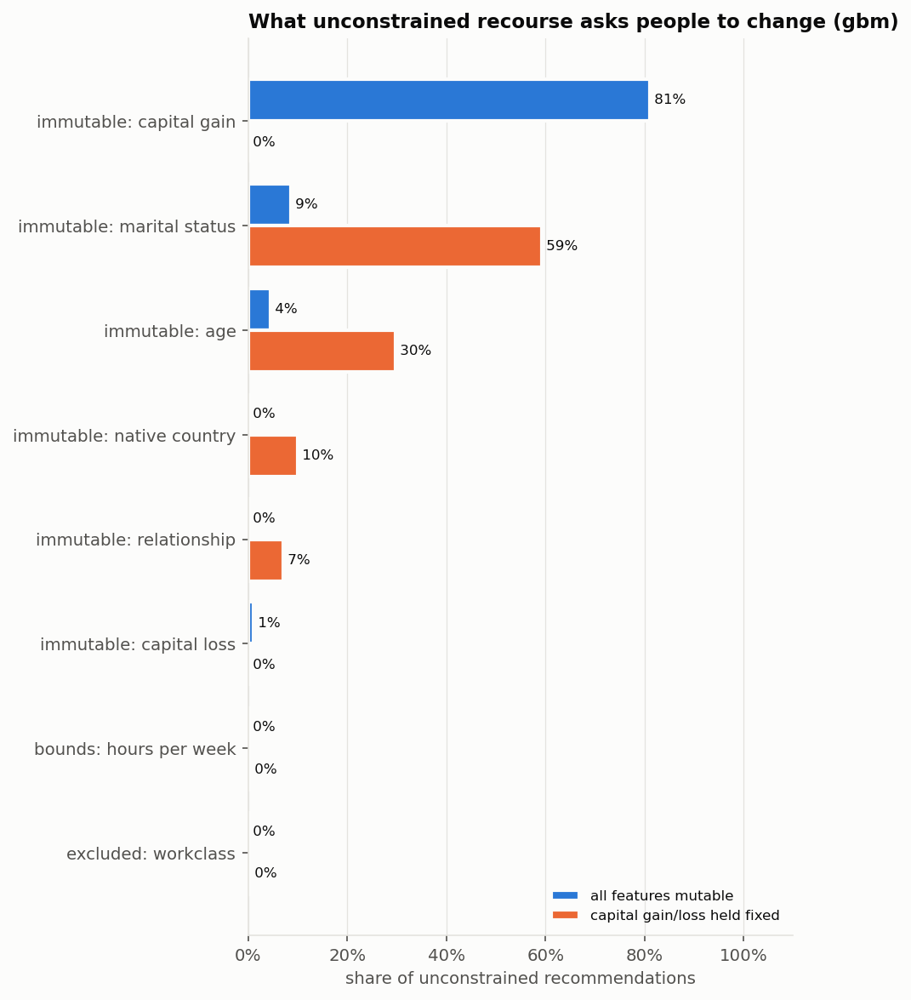
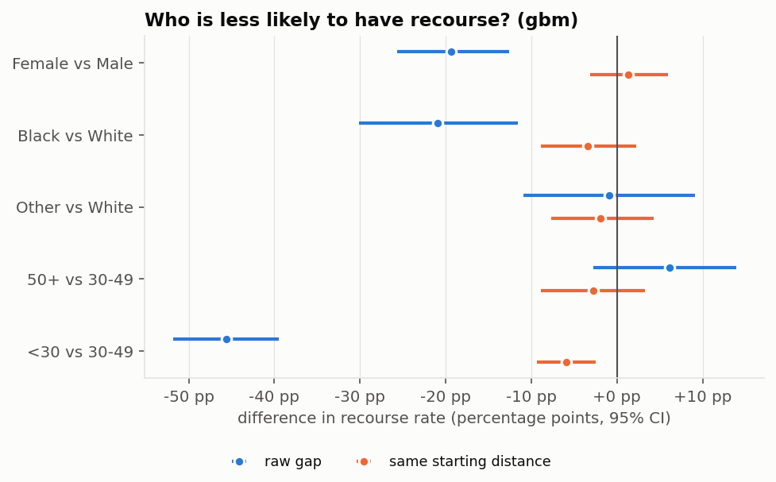
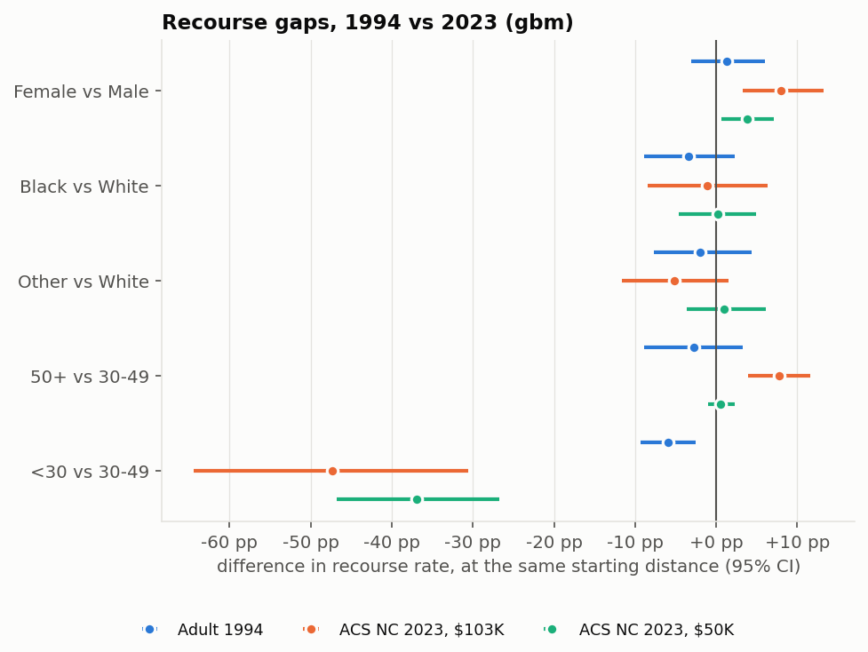
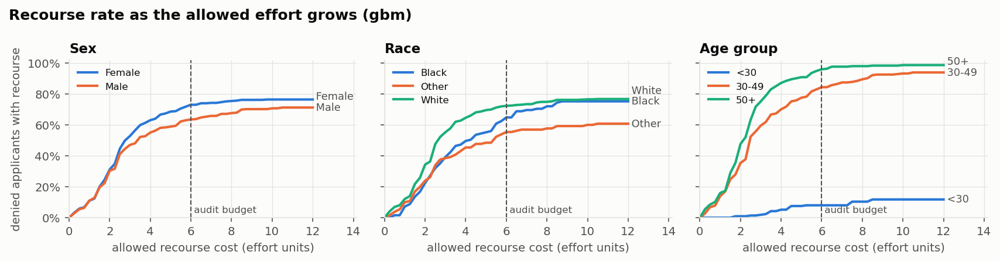

# Is Recourse Equally Open to Everyone? An Audit of Algorithmic Recourse in Public-Sector-Style Decisions

When an automated eligibility model says **no**, is there a realistic change the person
could make to get a **yes**, and is that path as open and as cheap for every group?
This report audits that question on the standard 1994 benchmark (UCI Adult) and on
2023 North Carolina census data (ACS), comparing **realistic recourse** (only changes a
person can actually make) with what an **off-the-shelf counterfactual tool** recommends.

**In short:**

- Off-the-shelf tools appear to give almost everyone a way out. However, **39–95% of
  their advice asks for something a person cannot change**, such as their age, marital
  status, or wealth.
- In the 1994 data, the large sex and race gaps in recourse are **explained by where
  people start**, that is, how far below the approval line they were.
- **Age is different.** Applicants under 30 have much less recourse even when compared
  with older applicants who started just as far from approval.
- **This age gap grew** from −6 percentage points in 1994 to −47 in 2023.

For setup, commands, and output files, see the [README](README.md). The app
(`make app`) lets you explore every result interactively.

---

## Contents

1. [Background](#1-background)
2. [Research question](#2-research-question)
3. [Approach](#3-approach)
4. [Results](#4-results)
5. [Why it matters](#5-why-it-matters)
6. [Intended use, stakeholders, and misuse](#6-intended-use-stakeholders-and-misuse)
7. [Limitations](#7-limitations)
8. [Future work](#8-future-work)
9. [References](#9-references)

---

## 1. Background

**From explanations to recourse.** Wachter, Mittelstadt and Russell [1] proposed
*counterfactual explanations*. These explain a decision by the smallest change to the
input that would have changed the output: "you would have been approved if your
income were $5,000 higher." Ustun, Spangher and Liu [2] pointed out that a
counterfactual is only useful to the person if they can act on it. They called an
actionable counterfactual **recourse**, and showed that it depends on which features
are treated as *immutable*, such as age or birthplace.

Barocas, Selbst and Raghavan [3] showed that counterfactual explanations rest on hidden
assumptions about which features can change and at what cost. Venkatasubramanian and
Alfano [4] argued that recourse matters morally, because it preserves a person's agency
over decisions made about them. Karimi et al. [5] survey the field. Karimi, Schölkopf
and Valera [6] show that ignoring causal links between features can produce advice that
doesn't actually work.

**Off-the-shelf tools.** Widely used generators such as DiCE [7] search for nearby
counterfactuals. By default, every feature may change. Users must specify constraints
themselves, and in practice they often don't.

**Fairness of recourse.** A model can have equal error rates across groups and still
give one group a much harder path to approval. Gupta et al. [8] proposed measuring and
equalizing recourse across groups. von Kügelgen et al. [9] distinguish group-level
recourse fairness from individual-level fairness. One complication runs through this
work: a group may have less recourse simply because its members start further from the
decision boundary. Separating that effect from a structural one is part of this audit.

**The benchmark problem.** Most recourse studies, including [2, 7, 8], evaluate on UCI
Adult, a 1994 Census extract. Ding et al. [10] argue that Adult should be retired. Its
$50K income label is three decades out of date, and conclusions drawn from it may not
transfer to current data. They introduced *folktables*, a set of tasks built on recent
American Community Survey data, including ACSIncome as a modern replacement for Adult.

**Public-sector stakes.** Automated decisions in public services have caused well-documented
harm when people could not understand or contest them, for example:

- Australia's Robodebt scheme [11]
- the Dutch childcare-benefits scandal [12]
- Michigan's MiDAS unemployment-fraud system [13]

Eubanks [14] documents how such systems affect low-income people. The EU AI Act treats
systems that determine access to essential public services and benefits as high-risk
[15], and GDPR Article 22 restricts decisions based solely on automated processing [16].
Recourse is the practical form of "a chance to respond": not only *why* you were
denied, but *what you can do about it*.

**This project's contribution:**

1. An **audit protocol** that measures how often unconstrained recourse breaks explicit,
   justified constraints (the *violation rate*) and compares recourse across groups with
   uncertainty estimates.
2. A **same-starting-distance comparison** that separates gaps explained by where groups
   start from gaps that remain when people start equally far from approval.
3. A **replication on 1994 and 2023 data** with an inflation-adjusted label, testing
   whether findings from the standard benchmark still hold.

## 2. Research question

> When post-hoc recourse methods suggest ways to reverse an automated denial, do the
> suggested changes require realistic, equitable effort across demographic groups, or
> do they prescribe changes no one can make? And do the answers from the 1994 benchmark
> still hold in 2023 data?

## 3. Approach

| | |
|---|---|
| **Data** | UCI Adult 1994 (48,842 people). ACS 2023 North Carolina via folktables, ACSIncome definition (56,486 workers), recoded to Adult's columns. |
| **"Approved"** | Income above $50K for Adult. For ACS: **$103K**, which is Adult's $50K in 2023 dollars (CPI-U 304.7 / 148.2), so both datasets use the same real-dollar bar. The standard ACSIncome bar of $50K runs as a robustness check. |
| **Models** | Logistic regression and gradient boosting. Sex and race are **not** model inputs, as most agencies require; proxies such as relationship and marital status are. |
| **Audit groups** | Sex; race (White / Black / Other); age (<30, 30–49, 50+). Each group is compared with the largest group: Male, White, 30–49. |
| **Sample** | About 800 denied test-set applicants per model and dataset, with at least 100 per group. |

**What counts as recourse.** Every feature is *immutable* (age, marital status,
relationship, birthplace, capital gains and losses), *monotonic* (education can only
increase), or *bounded* (hours 1–80 per week; work sector and occupation may change).
Each rule carries a one-line justification in
[`config/constraints.yaml`](config/constraints.yaml). Costs are in effort units, where
1 equals one extra year of school; 20 extra hours per week also costs 1. The budget is 6.

**Realistic recourse.** For each denied applicant, a model-agnostic search
([`src/recourse.py`](src/recourse.py)) looks for the cheapest approving change to at
most 3 allowed features:

1. Try every single-feature change.
2. Try 1,000 random combinations.
3. Take the best combination found and greedily shrink it back toward the applicant's
   original values while it still gets approved.

**Off-the-shelf baseline.** The same search, but every feature may change, cost is plain
standardized distance, and there is no budget. This mirrors the defaults of tools like
DiCE. For Adult, a second variant holds capital gain and loss fixed, so that the
violation rate is not driven by one feature.

**Statistics** ([`src/metrics.py`](src/metrics.py)):

- **Confidence intervals.** 95% percentile-bootstrap CIs (1,000 resamples) on every
  group gap.
- **Same starting distance.** Denied applicants are split into 5 bands by their starting
  approval probability. Each group is compared with reference-group members in the same
  bands, weighted by the group's own mix of bands. On synthetic data, this comparison
  removes a gap caused only by starting distance (−40 → −0.7pp) and keeps a real
  structural gap (−30 → −31pp). See [`tests/test_analysis.py`](tests/test_analysis.py).
- **Budget curves.** The share of each group with recourse as the allowed effort grows
  from 0 to 12.

**Model performance** (test set):

| Dataset | Model | Accuracy | AUC | Approved |
|---|---|---|---|---|
| Adult 1994 | gradient boosting | 0.877 | 0.930 | 20% |
| Adult 1994 | logistic | 0.855 | 0.906 | 19% |
| ACS 2023, $103K | gradient boosting | 0.878 | 0.894 | 11% |
| ACS 2023, $103K | logistic | 0.874 | 0.883 | 9% |
| ACS 2023, $50K | gradient boosting | 0.798 | 0.879 | 43% |
| ACS 2023, $50K | logistic | 0.782 | 0.861 | 44% |

## 4. Results

Figures show gradient boosting unless noted. Brackets are 95% bootstrap CIs, and
"pp" means percentage points. Every number comes from the CSVs in
[`data/processed/`](data/processed/), and every figure can be redrawn with
`make figures`.

### Finding 1: Off-the-shelf recourse mostly asks for the impossible

| | Off-the-shelf finds recourse | ...of which breaks a rule | Realistic recourse |
|---|---|---|---|
| Adult 1994 (all features mutable) | 100% | **95%** | 47% |
| Adult 1994 (capital gain/loss fixed) | 85% | **77%** | 47% |
| ACS 2023, $103K | 84% | **42%** | 68% |

Off-the-shelf recourse on Adult tells 81% of people to acquire capital gains. With
capital gains held fixed, the most common advice is to **change marital status (59%)**
or **age (30%)**.

### Finding 2: In 1994, the sex and race gaps are explained by where people start

| Adult 1994 | Raw gap | Same starting distance |
|---|---|---|
| Female vs Male | **−19 pp** [−26, −13] | +1 pp [−3, +6] |
| Black vs White | **−21 pp** [−30, −12] | −3 pp [−9, +2] |

Women and Black applicants are denied further from the approval line. At the same
starting distance, the model offers them recourse at about the same rate.

The burden is not equal, though. **Women who do have recourse need +1.04 more effort
units** [+0.67, +1.38], about a year of school. With the logistic model, a small sex gap
remains even at the same starting distance (−7 pp [−11, −3]).

### Finding 3: Age is a structural gap, and it grew between 1994 and 2023

| Under-30 vs 30–49 | Raw gap | Same starting distance |
|---|---|---|
| Adult 1994 | −46 pp [−52, −40] | −6 pp [−9, −2] |
| **ACS 2023, $103K** | **−76 pp** [−82, −71] | **−47 pp** [−64, −31] |
| ACS 2023, $50K | −44 pp [−50, −39] | −37 pp [−47, −27] |

In 2023 data, the model approves only 0.3% of under-30s and wrongly denies 98% of those
who qualify. Once denied, **only 8% have realistic recourse**. That is not
explained by where they start: they still trail older applicants by 47 pp at the same
distance from approval. The result holds under both income bars. The logistic model shows
the same direction at a smaller size (−17 pp [−26, −10] at the same starting distance).

**More effort does not close the gap.** At twice the audit budget, 12% of denied
under-30s have recourse, compared with 94% of 30–49-year-olds. The model's denial of
young people rests on features they cannot change.

### Finding 4: Off-the-shelf tools mislead most where real recourse is scarcest

Gap in how often unconstrained advice breaks a rule, compared with the reference group:

| | Adult 1994 (capital fixed) | ACS 2023, $103K |
|---|---|---|
| Under-30 vs 30–49 | **+23 pp** [+18, +29] | **+58 pp** [+51, +65] |
| Female vs Male | **+21 pp** [+16, +27] | +2 pp [−5, +10] |
| Black vs White | **+12 pp** [+3, +20] | −0 pp [−11, +10] |

In 2023, **93% of off-the-shelf recommendations for under-30s amount to "be older"**
(median recommended age: 48). A tool that reports recourse for everyone hides exactly the
group that has none.

### Finding 5: Some 1994 patterns no longer hold

In 2023, women have *more* recourse than men (+9 pp [+3, +16] raw; +8 pp [+3, +13] at the
same starting distance). The Black vs White gap is no longer significant (−7 pp
[−16, +2]). Auditing only on the 1994 benchmark would have overstated the raw race gap and
understated the age gap.

## 5. Why it matters

- **Error rates tell only half the story.** The model wrongly denies 98% of qualified
  under-30s in 2023, so an error-rate audit would flag age. It would not show that, once
  denied, almost none of them have anything they can do about it. Recourse measures that
  second harm.
- **Unconstrained explanations are misleading in practice.** Their advice is most often
  impossible for the groups with the least real recourse. If an agency gives applicants
  explanations, the constraints have to be explicit and justified, and this audit shows
  one way to write them down.
- **Separate starting distance from structure.** A raw gap invites the wrong fix. If the
  gap comes from where people start, the question is why they start there. If it is
  structural, the question is why the model leans on what people cannot change.
- **Re-audit on current data.** The benchmark everyone uses gave a different picture from
  2023 data on two of the three attributes.

## 6. Intended use, stakeholders, and misuse

**Intended use.** This is a research audit on public survey data. It is meant for
**auditors and agencies** evaluating a decision model before deployment, and for
**researchers** comparing recourse methods. It is not an eligibility system.

**Stakeholders.**

- **Applicants**, who bear the cost of denials and of bad advice.
- **Caseworkers**, who relay decisions.
- **Agencies and vendors**, who choose models and explanation tools.
- **Regulators and advocates**, who need evidence of disparate burden.

**Misuse to avoid.**

- **Advising individuals.** This tool should not be used to tell a real person what to
  change.
- **Certifying fairness.** Equal recourse is necessary but not sufficient, and a model
  can pass this audit and still be unfair in other ways.
- **Fairwashing.** Publishing only the favourable configuration hides the rest; the
  constraints and costs are choices that should be reported with any result.
- **Gaming.** Knowing which features flip a decision could help people misrepresent
  their information.

## 7. Limitations

- **The label is a proxy.** Income above a threshold is not a real benefit decision, and
  in means-tested programs a *lower* income qualifies. The contribution is the audit
  protocol, which transfers to any agency model.
- **Costs and immutability are judgments.** Treating marital status as immutable, or 20
  hours as equal to a year of school, are explicit choices kept in one file. Changing
  them changes the numbers. The budget curves show how sensitive results are to the
  budget.
- **The search is heuristic.** "No recourse found" means none was found within the action
  space and budget, not proof that none exists.
- **Starting-distance bands are coarse.** Five bands reduce, but do not remove,
  differences in where groups start. The intervals for under-30s are wide because few
  start near approval.
- **Features are treated as independent.** Gaining a degree takes years, during which a
  person ages, and the search ignores such causal links [6].
- **Recoding ACS to Adult's columns is approximate.** This covers 24 school levels to 16,
  about 530 occupation codes to 23 groups, and birthplace to world region.
- **Groups are coarse.** Race is White / Black / Other, and intersections such as young
  Black women are not audited separately.
- **One state, one model family per run.** North Carolina may not generalize, and results
  vary in size between logistic regression and gradient boosting, though not in
  direction.
- **Recourse is for the model as trained.** After retraining, a recommended change may
  no longer lead to approval.

## 8. Future work

- **Other recourse generators.** Run DiCE [7] and other methods through the same
  violation-rate protocol.
- **Causal and time-aware recourse.** Model the fact that education takes time, and
  distinguish "wait N years" from "never."
- **A real eligibility label.** Use folktables' ACSPublicCoverage, where *lower* income
  qualifies, or an agency's own model.
- **Intersectional groups**, more states, and more survey years.
- **Elicit costs from stakeholders** instead of assuming them, for example by asking
  applicants and caseworkers how hard each change is.
- **A user study** on how applicants perceive constrained versus unconstrained advice.

## 9. References

1. Wachter, S., Mittelstadt, B., & Russell, C. (2017). Counterfactual explanations without opening the black box: Automated decisions and the GDPR. *Harvard Journal of Law & Technology*, 31(2).
2. Ustun, B., Spangher, A., & Liu, Y. (2019). Actionable recourse in linear classification. *Proceedings of FAT\* 2019*.
3. Barocas, S., Selbst, A. D., & Raghavan, M. (2020). The hidden assumptions behind counterfactual explanations and principal reasons. *Proceedings of FAT\* 2020*.
4. Venkatasubramanian, S., & Alfano, M. (2020). The philosophical basis of algorithmic recourse. *Proceedings of FAT\* 2020*.
5. Karimi, A.-H., Barthe, G., Schölkopf, B., & Valera, I. (2022). A survey of algorithmic recourse: Contrastive explanations and consequential recommendations. *ACM Computing Surveys*, 55(5).
6. Karimi, A.-H., Schölkopf, B., & Valera, I. (2021). Algorithmic recourse: From counterfactual explanations to interventions. *Proceedings of FAccT 2021*.
7. Mothilal, R. K., Sharma, A., & Tan, C. (2020). Explaining machine learning classifiers through diverse counterfactual explanations. *Proceedings of FAT\* 2020*.
8. Gupta, V., Nokhiz, P., Roy, C. D., & Venkatasubramanian, S. (2019). Equalizing recourse across groups. *arXiv:1909.03166*.
9. von Kügelgen, J., Karimi, A.-H., Bhatt, U., Valera, I., Weller, A., & Schölkopf, B. (2022). On the fairness of causal algorithmic recourse. *Proceedings of AAAI 2022*.
10. Ding, F., Hardt, M., Miller, J., & Schmidt, L. (2021). Retiring Adult: New datasets for fair machine learning. *Advances in Neural Information Processing Systems (NeurIPS) 34*.
11. Royal Commission into the Robodebt Scheme (2023). *Report*. Commonwealth of Australia.
12. Parliamentary Interrogation Committee on Childcare Allowance (2020). *Ongekend onrecht* (Unprecedented injustice). House of Representatives of the Netherlands.
13. Charette, R. N. (2018). Michigan's MiDAS unemployment system: Algorithm alchemy created lead, not gold. *IEEE Spectrum*.
14. Eubanks, V. (2018). *Automating Inequality: How High-Tech Tools Profile, Police, and Punish the Poor*. St. Martin's Press.
15. Regulation (EU) 2024/1689 (Artificial Intelligence Act), Annex III, point 5.
16. Regulation (EU) 2016/679 (General Data Protection Regulation), Article 22.
